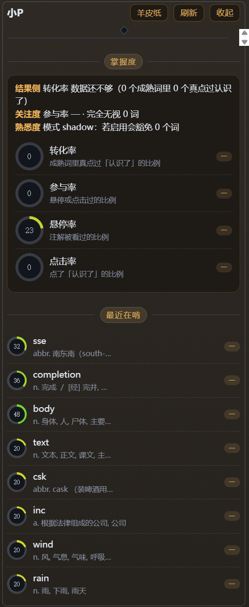

# OpenGloss

**读英文网页时随手查词，忙完再回顾今天接触过的词。**

OpenGloss 是一个在本机运行的英语阅读辅助工具：网页中自动标注词语，悬停查看中文释义，按需反馈「认识了」。小 P 留在网页旁，提供侧栏、人格和可选的 AI 交流；今日识单把当天接触的词整理成可选择、可打印的清单。没有必须完成的课程、测验或打卡。

Local-first vocabulary assistance for everyday web reading. Hover for definitions, record explicit feedback, and print a daily contact list. Basic assistance works without AI.

[安装与开始使用](#快速开始) · [完整使用说明](安装说明.md) · [发行与下载](https://github.com/luomeii/OpenGloss/releases) · [更新记录](CHANGELOG.md)

*本说明对应 v0.4.1 正式版，汇总 v0.4.0 测试阶段以来保留的功能与修补；下载请以发行页实际提供的同版本附件为准。*

## 适合谁

- 经常看英文网页，想少切换页面查词的人。
- 阅读时比较忙，想先看内容、有空再回顾当天词语的人。
- 想让 AI 陪着解释和交流，同时自己决定何时调用的人。

适合把英语学习放进日常阅读；如果你需要完整课程、考试训练或每个句子的准确翻译，目前这些功能还不能替代专门工具。

## 用起来是什么样

**阅读时：** 打开英文网页，部分词会有标注；鼠标放上去就能看中文意思，觉得目前认识可以顺手点一下。不配置 AI 也能用。

**忙的时候：** 不必逐个查看或点按钮，继续读就好。系统会留下当天选过的词，但不会仅凭选中就认定你学会了。

**有空的时候：** 打开今日识单，挑几词回顾，打印出来或保存成 PDF。想多问一句，再打开小 P 聊天；AI 需要你自己的服务地址、模型和密钥。

比如白天翻了几篇资料，晚上可以从当天清单里选 10 个词打印。清单能帮你找到接触过的词，不代表这 10 个词已经掌握。

## 界面展示

以下三张是测试网页上的界面示例。图中词语和计数用于展示，不是学习效果或本版全部功能通过的证明。

### 在网页里看标注


*边看英文网页，边查看词语；侧栏仍在原网页旁边。*

### 鼠标放上去查词


*不用离开文章查看中文释义。词卡文字和状态以当前版本为准。*

### 小 P 与侧栏

<p align="center">
  
</p>

*查看近期词语和使用记录；统计数字不等于实际掌握程度。*

## 快速开始

### 第一次使用：按这六步走

适用于 Windows 10/11 x64。下载**完整 Windows 离线安装 ZIP**，不要下载 GitHub 自动生成的 Source code 包代替。自带 Python、依赖和完整词典；扩展手动加载。无需先配 AI、口令或配对。

1. **完整解压。** 从[发行页](https://github.com/luomeii/OpenGloss/releases)取得对应版本的离线 ZIP 和 `.sha256`，核对 SHA256，解压到准备长期使用的本地可写新目录。若已有旧版在运行，先用旧目录的停止入口停止它，保留旧文件和数据。
2. **安装并等待启动成功。** 双击根目录 `Install.cmd`。它校验自带组件、生成四个快捷方式，并且**自动启动引擎**，无需再双击启动。看到 `[PAE] engine ready: http://127.0.0.1:4815/v1/health` 才算后台程序已启动；仅看到文件检查成功时还要继续等。按任意键关闭安装窗口后，引擎继续在后台运行。
3. **手动加载浏览器扩展。** Edge 地址栏输入 `edge://extensions`，Chrome 输入 `chrome://extensions`；开启「开发者模式」→「加载已解压的扩展程序」→选择本安装目录的 **`pae/extension`**。不要选 ZIP 或安装根目录。换版先停用旧扩展，加载新版后刷新已打开的网页。
4. **打开并收藏本地首页：<http://127.0.0.1:4815/>。** 这是管理和识单的统一入口，不需要口令。日常设置进[轻量管理](http://127.0.0.1:4815/manage)：页面标注上限、静音、AI 连接与总控、后台提醒。人格编辑和今日识单也都能从首页进入。
5. **打开英文网页，先试基础辅助。** 扩展开关开启后刷新网页，悬停标注看中文释义；确实目前认识的词可以点「认识了」，等显示已记录。网页右下角小 P 胶囊可展开原面板/侧栏。不配 AI 也能标注、查词、反馈和打印识单。
6. **按需要再配 AI、打印和自启。** 想聊天再按[可选 AI](#可选-ai)保存连接并开启总控，回网页发消息；忙完打开[今日识单](http://127.0.0.1:4815/daily)，选词打印或保存 PDF。只有希望登录 Windows 后自动运行时，才双击 `autostart_on.lnk`。

**安装好后不必依次运行四个快捷方式。** 它们是供以后选择的操作；`Install.cmd` 已经尝试启动服务，自启仍默认关闭。

PowerShell 校验示例：

```powershell
Get-FileHash .\OpenGloss-v0.4.1-windows-x64-offline.zip -Algorithm SHA256
```

将输出与该包的 `.sha256` 文件对照。离线包安装不需要另装系统 Python、管理员权限或安装时联网；其他浏览器兼容性以实际验收为准。

### 本地页面：去哪做什么

下面都是你自己电脑的地址，**需要后台程序正在运行**。关闭页面不会停止后台服务；无法访问时先运行启动入口。

| 页面 | 地址 | 用途 |
| --- | --- | --- |
| 本地首页 | <http://127.0.0.1:4815/> | 从这里进入各个功能，建议收藏 |
| 轻量管理 | <http://127.0.0.1:4815/manage> | 引擎状态、页面上限、静音、AI 地址/模型/密钥、后台许可 |
| 人格面板 | <http://127.0.0.1:4815/panel> | 编辑人格设置，预览并保存；试说需要先打开 AI |
| 今日识单 | <http://127.0.0.1:4815/daily> | 按日期回顾接触词、反馈依据，分页勾选与打印 |
| 健康检查 | <http://127.0.0.1:4815/v1/health> | 故障排查时确认是否就绪，返回技术信息 |

普通使用无需打开 API 文档或修改学习权重；标注、词卡和小 P 聊天仍在原网页操作。

### 以后每天怎样开启与关闭

| 安装根目录入口 | 对应脚本 | 什么时候用 |
| --- | --- | --- |
| `quick_start.lnk` | `pae/quick_start.bat` | 没开自启时，开始使用前启动本安装引擎 |
| `quick_stop.lnk` | `pae/quick_stop.bat` | 暂时不用或切换版本时，停止可确认归属本安装的引擎 |
| `autostart_on.lnk` | `pae/autostart_on.bat` | 自愿启用当前用户登录 Windows 后自启；不等于开机未登录时运行 |
| `autostart_off.lnk` | `pae/autostart_off.bat` | 取消以后登录的自启；需要现在停服务，还要运行停止入口 |

例如：今天运行 `Install.cmd` 成功后直接使用，无需再启动。明天未开自启，就先运行 `quick_start.lnk`；已经登记自启时，登录后先检查首页是否可访问，必要时再启动。只想安静些可以在管理页静音；想完全停止后台运行，使用 `quick_stop.lnk`。

默认使用本机地址 `127.0.0.1:4815`。提示其他版本正在使用这个地址时，先从旧版目录停止它；不知道属于哪个程序时，不要强行结束。快捷方式只是入口，不能丢掉 `pae/` 内脚本或自带运行时。安装器不自动登记自启、不改系统 PATH、不创建桌面入口。

### 升级与回退

本版是**手动下载、新目录安装**，没有自动更新或自动数据迁移。用旧版备份工具为日用数据库生成快照，保留旧程序；回退时使用旧程序和对应旧库快照，不要让旧程序直接打开新版使用过的数据库。

扩展采用固定公开身份。本版保持该身份不变，但更早的手动加载版可能被浏览器识别为另一扩展，开关和地址不保证承接。停用旧扩展、加载新版、核对设置，再刷新网页，避免重复标注。manifest 的 `key` 是公开身份字段，不是 AI 密钥。

移动目录前在原位置取消自启、停止引擎，在新位置重新安装并按需开启自启。卸载见[安装说明](安装说明.md#卸载离线版)。

## 日常使用

| 想做什么 | 去哪里、怎么做 |
| --- | --- |
| 查看词义 | 鼠标放到网页标注上，看中文释义；不需要 AI |
| 标记目前认识 | 词卡点「认识了」，等显示已记录；这不是永久掌握证明 |
| 看近期词语、找小 P | 点击网页右下角橙色胶囊，展开原面板和侧栏 |
| 调整标注多少 | 打开[轻量管理](http://127.0.0.1:4815/manage)，设置每页上限并保存，刷新网页观察 |
| 改人格、减少主动说话 | 管理页进入人格编辑，或打开「静音主动说话」 |
| 回顾、打印今天的词 | 打开[今日识单](http://127.0.0.1:4815/daily)，选词后打印或保存 PDF |

**没有时间查看也没关系。** 新选中的词只留下接触记录，不会直接增加学习分；鼠标查看和点击认识仍按现有规则记录。以前已有的历史不会被重新改写，少互动的词以后也可能再次标注。

**点击后怎样确认？** 先等词卡显示已记录；今日识单的对应词条也会说明当天是否记录过认识反馈。目前没有单独的全部反馈搜索页。换一篇网页后不一定再次标到原词，不能据此判断丢了记录。

**分数怎么看？** 熟悉度只是程序根据记录和时间计算的参考值，不代表真正学会。每页可设 8–80 个标注，默认上限 40；内容不够时会少标，不会凑满。程序分批选词，默认一批 8 个，不是整页固定只有 8 个。

## 今日识单

从[今日识单](http://127.0.0.1:4815/daily)选日期，查看这一天的完整**已记录选词**、中文释义及悬停/认识反馈依据。这里只说明系统选中过哪些词，不表示你一定看见、读懂或学会了。

1. 顶部列出**最多 10 个**现有回顾提示词：当天未反馈认识，且悬停过或被系统选中至少两次。只有重复选中时会说明「未记录悬停」，不冒称你关注过或不会。
2. 完整清单**每页 20 词**，所有记录仍保留。打开时会先勾选建议词，没有建议词时不会硬凑；可以跨页增减，选 11 个或更多也可以。
3. 点击「打印所选」只打印勾选词；「打印全部记录」包含屏幕其他页。浏览器打印对话框可保存 PDF。
4. Ctrl+P 遵从当前打印范围。零选择不会偷偷打印全单；取消打印保留选择和当前页，切日期重新初选。选择只在当前页面保存，不写学习记录。

例如当天记录了 85 词：屏幕显示 5 页；你在几页中勾选 11 词，打印所选得到这 11 词，而不是只印当前页或全部 85 词。纸张页数取决于释义长度与打印设置，不保证固定两页 A4。

本页不自动调用 AI；如果翻页和勾选功能没有加载出来，会显示完整清单，此时 Ctrl+P 打印全部。**目前只有中文义，英文解释和独立词性标为「未提供」；完整离线中英双释尚未完成。** 分页方便查看，全部记录仍会一起读取，不能据此保证占用内存更少。

## 可选 AI

基础标注、词典、统计和识单无需 AI。只想主动聊天时，按下面顺序配置：

1. 打开[轻量管理](http://127.0.0.1:4815/manage)，填写兼容 Chat Completions 的 API 地址、模型 ID 和你自己的密钥。
2. 勾选「允许 AI 调用」，点击「保存连接与总控」。确认显示已保存；保存后不会重新显示密钥，不代表丢失。
3. 回到英文网页，展开小 P，在原输入框发送一句话，实际回复才是连接成功的依据；保存设置本身不请求模型。
4. 只想自己问时调用，就保持「后台与主动提醒」内各项关闭。不必为聊天开启这些后台项目。

不要截图或分享密钥；后台用途如要使用，另行勾选并点击「保存后台与提醒」。

| 控制 | 默认与生效方式 |
| --- | --- |
| AI 总控 | 默认关闭，控制后续新模型请求；不会撤回已发请求 |
| 连接设置 | 与后台设置分别保存；保存/清除密钥本身不请求模型，也不是连通测试 |
| 悬停后台义项实验 | 默认关闭，需独立许可；可能发送对应句子，只写缓存，不改变当前释义 |
| 主动提醒 | 默认关闭；规则模板可独立启用，AI 文本还需总控与主动 AI 许可 |
| 主动提醒间隔 | 后台组保存，须为 30–1440 分钟整数；仅约束曝光触发提醒，原门槛、日额、静音仍有效 |
| 定时巡检 | 独立许可；本版建议保持关闭，调权重放仍有已知限制 |

后台组点击「保存后台与提醒」。两个区域要分别点保存。下面的提醒间隔填错，不会挡住上面的连接保存；保存连接也不会替你开启后台功能。没点保存就不会生效，保存失败时先按页面提示处理。静音不是 AI 总控。

主动提醒的间隔目前只能设置 **30–1440 分钟的整数**。这是「两次之间至少等多久」，不是每隔这么久必定发一条：还要有足够的新接触、合适候选词、未静音和剩余日额。规则提醒另有每日最多 3 条、其中 AI 文本最多 2 条的既有限制；其他说话也可能占用共用配额。填 1 分钟目前会被拒绝，不是连接故障。想测试聊天可直接主动发消息，不用等待提醒。

### 地址怎么填

| 提供方给出的地址 | 本版处理 |
| --- | --- |
| 服务根地址 | 追加 `/v1/chat/completions` |
| 末尾 `/v1` 的地址 | 只补 `/chat/completions` |
| 完整 `/chat/completions` 接口 | 原样使用 |

代理前缀保留。其他路径沿用根地址拼法，不猜测其他协议或失败后换地址重试；特殊代理如依赖重复 `/v1`，请明确填写完整接口。提供方必须兼容 Chat Completions。

配置优先级是 `PAE_LLM_*` 环境变量 → 管理页保存设置 → 原配置/默认值，页面显示来源。密钥留空会保留；清除只影响管理页保存值，不会清除环境变量。默认保存于明文 `pae/user_controls.json`，接口不回显密钥，**不要提交、截图或分发此文件**。

AI 关闭或缺密钥时，小 P 给出中文说明，不自动开启或重试。调用失败/空回复会提示；只有既有记忆写入成功且没有其他可显示回复时才用「记下了」。能否成功回复取决于服务商、模型、密钥和网络。

## v0.4.1 正式版更新

这是从 v0.3.7 经 v0.4.0 测试阶段整理而来的正式版本。以下包含测试阶段已经加入、正式版继续提供的改进，不只列最后一批修补。

### 阅读、反馈和回顾

- **反馈有确认也能回看**：「认识了」等后台确认后显示已记录，同一 UTC 日避免重复计分；重新悬停和今日识单可核对当日反馈。写入失败不会继续假报成功，学习记账会暂停并提示重启恢复。
- **浏览记录与学习分分开**：新选中只记接触，忙着翻网页、没查看词卡时，不会仅凭后端选中增加学习证据；旧历史不重算，悬停和主动反馈保留原规则。当前分数按原半衰期读取，不把旧分数一直当作现在的熟悉度。
- **标注数量可控**：每页上限可设，分批请求按剩余额度处理；补齐开关恢复和旧响应保护。同批符合条件且没有学习状态的词中，未记录词优先、已有词补位，仍可能跨批重复。
- **今日识单可挑着打印**：按本机日期整理接触记录和中文义，最多 10 个回顾提示、完整清单每页 20 词；跨页勾选、打印所选或全部，也可保存 PDF。记录保留完整，不把选中或悬停当成真正掌握。

### 管理、AI 与安装

- **常用设置集中到本地首页**：从 <http://127.0.0.1:4815/> 进入管理、人格和识单。管理免口令，可调页面上限、静音、AI 地址/模型/密钥及后台许可；原网页词卡、侧栏和小 P 位置保留。
- **AI 由使用者决定何时调用**：总控与各后台用途默认关闭；连接/总控和后台/提醒分组保存，保存配置本身不请求模型。聊天给出未开启、缺配置或空回复提示，普通空回复不再冒充已记忆。
- **AI 地址更好填写**：兼容根地址、末尾 `/v1` 和完整 `/chat/completions`；跨域名、端口或协议跳转停止跟随，避免将密钥随跳转转发到另一来源。每次操作不额外自动重试。
- **离线包带齐运行环境**：Windows x64 自带 Python、依赖与词典，双击 Install 后自动尝试启动；扩展仍手动加载。提供启动、停止、开启/关闭登录自启四个入口，启停和自启检查安装归属。
- **显示与接入修补**：处理深色网页胶囊外白底；补齐来源及角色身份检查、真实绘制记录和上下文裁剪退出；同步正式版元信息、词典故障提示与完整使用说明。Git 换行规则保留构建锁定字节。

完整离线中英双释、AI 学习单、自动更新和自动迁移尚未完成。正式版保留项、验证条件见下方及 [CHANGELOG](CHANGELOG.md)，版本号不代表所有历史问题已清零。

**运行内存已有优化，但仍需长期测量。** 发行词典按需读取，减少整库常驻。此前同一 Windows 运行时、3 万条合成历史的受控对照，完成相同合成阅读操作后，空闲 3/25 秒观察的服务进程工作集由 297.3/295.4 MiB 降至 103.6/103.4 MiB，约降 65%。这是历史候选工况，不是本包新测量、浏览器总占用或每台机器的最低值保证。

## 数据与隐私

基础处理在本机完成。数据库默认 `pae/pae.db`，备份在 `pae/backups/`，人格在 `pae/persona/`，管理设置在 `pae/user_controls.json`，外部接入密钥在 `pae/keys.json`。发行包不预置日用记录；公开词典 `dict.sqlite` 是词典数据，不是用户数据库。

- **记录什么**：学习事件、词与反馈、对话、事实及审计。旧遭遇/部分悬停可能保存网页句子；展示记录沿用页面地址、会话及加载后经过时间，`page_active_ms` 不代表认真阅读时长。新接触仅记词头；视口观察不存网页地址/正文，也不加学习分。
- **何时出网**：启用相应用途后，聊天可发送提问、事实、近期词和指标；获许可的悬停实验可发送句子。保存配置不触发模型；后台额度不是硬费用上限。
- **网页能看到什么**：小 P 输入/历史、精确分数和确认状态在扩展框架内显示；网页仍可观察自己文档的高亮范围、词和色档，并影响容器显示，不是所有词级信号都对网页保密。展示只计新增绘制，观察由扩展内部生成；可见采样不能证明读懂。
- **本机服务边界**：写入口检查同源及固定扩展 Origin，外部密钥与内置角色按确定身份执行；无 Origin 的既有本机调用仍保留。公开扩展身份可被复制，这不是防所有恶意扩展或本机程序的强认证。不要向局域网或公网转发服务。

默认库备份用 `pae/backup.bat` 的 SQLite 快照；人格与设置另备。运行时只复制 `pae.db` 可能遗漏 WAL/SHM。分发或清理前需检查数据库、备份、日志、设置、密钥和自定义路径，不能把已经使用过的安装目录当作净源。

## 已知限制与排查

排查某个词的认识反馈时，可保留原英文网页，重启后台程序后再次悬停原标注词；也可只读打开 `http://127.0.0.1:4815/v1/feedback?lemma=example`，把 `example` 换为词条原形，查看 `recorded`。这个查询按 UTC 日判断，不是永久掌握词库；UTC+8 地区早上 8 点换日。今日识单按电脑本地日期，两者在日界附近可能不同。

本版优先实用的阅读辅助，不承诺应试提分、自动掌握、完整语境消歧或历史缺陷已清零。

| 现象/边界 | 处理与影响 |
| --- | --- |
| 装好没有标注 | 确认真正 ready、扩展已启用且来自本目录，再刷新英文页；浏览器保护页不保证可标 |
| 端口冲突 | 默认 4815，先核归属，不停未知实例；只改启动端口不等于启停/自启全套隔离，非默认生命周期未作完整支持声明 |
| 日期看起来不同 | 今日单用本机日；趋势、配额及认识去重用 UTC 日，UTC+8 地区早上 8 点换日 |
| 接触却没有学习分 | 新选中只记接触，没有悬停/反馈可尚无学习评分，也可能重复标注 |
| AI 没回复 | 查总控、有效配置来源、模型和地址；基础功能无需 AI |
| AI 地址发生跳转 | 跳到其他域名、端口或协议时停止跟随，避免继续转发鉴权头；确认服务可信后，在原管理页填写最终接口，再自行重试。同来源沿用原处理，不自动重试或开启 AI；初始 HTTP 配置仍可用，敏感使用建议填 HTTPS 最终接口 |
| 关 AI 后还有回复 | 已发请求不撤回；静音也不等于总控 |
| 文件参数没生效 | `annotate_max_s`、`max_ann_per_page`、`daily_say_cap` 文件初值读取有遗留缺陷；参数层初始为 0.75/40/10 再叠加保存设置。页面上限先用管理页，不突然激活旧自定义值 |
| 调权后重启分数变了 | 运行和重放可能用不同参数解释历史；建议保持定时巡检关闭，不保证旧覆盖自动清除 |
| 临时记忆过期仍出现 | active/search 的 TTL 有缺口，不能依赖它自动移除敏感临时事项 |
| 后台额度不是硬上限 | 义项实验日 150 按成功结果计数，非全部请求尝试；需要费用限制时保持后台许可关闭 |
| 上下文过长 | 词表可裁为空以结束裁剪，固定资料仍可能超预算；估算不是模型硬长度保证 |
| 长历史资源成本 | 接触去重集合会增长，部分统计同步重算；长期内存、延迟与异常超大输入容量仍待持续测量 |

完整离线双语识单、可控 AI 辅助学习、记忆/重放语义、长历史资源和更新体验保留为后续方向。

## 技术与开发

```text
英文网页 → 扩展提取/分批请求 → 本机 API → 本地词典与选词
           ↓ 绘制/悬停/反馈        ↓ 事件与投影
       原网页标注 + 小 P       SQLite → 侧栏 / 今日识单 / 管理
                                           ↓ 可选、受许可
                                  Chat Completions 模型
```

- **事件与投影**：追加事件，派生学习/接触状态；新接触不等于学习证据，旧事件不重算。查询分数按时间衰减，历史调权重放仍有限制。
- **按需词典**：校验后的公开发行词典按索引查释义；自建/其他兼容词典可能仍整库加载，不能套用同一资源结论。
- **页面生命周期**：扩展管理页面剩余额度、开关与旧响应，后端限制单次预算；不是服务端跨请求页面总额状态。
- **观察与调度**：新增视口观察独立记录，不计学习证据、AI 活动门槛或学习重放。
- **共享能力面**：HTTP 与 stdio/MCP 共用权限检查；参数提案有范围、冷却和有效期约束。学习事务故障保护不代表所有共享状态已获无限并发保证。

| 路径 | 内容 |
| --- | --- |
| `pae/extension/` | 扩展、标注、词卡与网页小 P |
| `pae/pae_core/` | API、学习事件、能力、人格与 AI 接缝 |
| `pae/config.json` | 公开默认配置，不放真实密钥 |
| `resources/ECDICT/` | 词形资料；完整词典另下或随离线包提供 |
| `distribution/` | 输入锁、离线构建器、安装器 |
| `scripts/build_dict.py` | 构建源码用户词典 |
| `skills/pae-bridge/SKILL.md` | 外部 AI 接入说明 |

`pae` 是保留的内部代号，目录、数据库、环境变量和能力名沿用它。

### 从源码运行

需要 Python 3.10+。Windows 离线包使用 Python 3.12 和锁定依赖；本版不据此宣称 Linux/macOS 首用已验收。

1. 获取仓库，根目录执行 `python -m pip install -r requirements.txt`。本版构建/隔离验证使用 FastAPI 0.115.12、Pydantic 2.11.4 等，见[输入锁](distribution/inputs.lock.json)；最低版本范围不代表任意新组合都已通过。
2. 从 [v0.3.1 词典附件](https://github.com/luomeii/OpenGloss/releases/tag/v0.3.1)下载 `dict.sqlite` 放入 `resources/ECDICT/`。离线包已经自带。也可依[词典说明](resources/ECDICT/README.md)准备 CSV 后运行：

   ```text
   python scripts/build_dict.py --csv resources/ECDICT/ecdict.csv --out resources/ECDICT/dict.sqlite
   ```

3. 进入 `pae/`，Windows 用 `start_engine.bat`；手动启动命令为：

   ```text
   python -m uvicorn pae_core.api:app --host 127.0.0.1 --port 4815
   ```

4. 确认 health 就绪，再加载扩展和刷新网页。缺失/损坏词典时应报告未就绪。

### 构建与测试

按锁中的公开 URL、大小、SHA256 准备输入，再执行 `python distribution/build_release.py --inputs <输入目录> --output <新ZIP>`，详见[维护者重新打包](安装说明.md#维护者重新打包)。`baseline_commit` 是历史基准，不代替最终源码清单；修改锁定文件后须同步哈希并重新构建。 本版 Git 属性保留已锁定文件的换行字节；不要另行批量格式化后沿用旧锁。

开发另装 `requirements-dev.txt`，从 `pae/` 可运行 `python -m pytest pae_core -q`；浏览器测试按对应脚本准备 Playwright。**历史入口 `pae/tests/nightly.py` 可能停止或重启 4815 实例，只能在独立测试环境使用。**离线用户包不包含项目开发测试与样本。

外部接入可在 `pae/` 用 `python -m pae_core.keys issue ext:名称` 签发密钥，按[桥接说明](skills/pae-bridge/SKILL.md)调用；JSON HTTP 请求应发送 `Content-Type: application/json`。外部密钥不是网页基础使用的前置条件。代码评审编号是历史溯源线索，不表示内部规划已随产品公开。

## 许可

代码与文档采用 [MIT](LICENSE)。词典来自 [ECDICT](https://github.com/skywind3000/ECDICT)，保留上游署名；随包 Python 和依赖保留各自许可。

**词形文件例外**：`resources/ECDICT/lemma.en.txt` 文件头声明 “free to use for any research and/or educational purposes”，比 MIT 更窄。商用或再分发前请阅读原文或联系作者，不能把整个数据集一概称为无条件 MIT。
