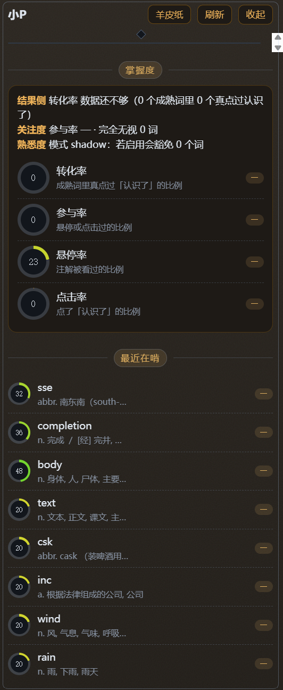

# OpenGloss

**在你本来就要读的英文网页上，提供低干扰的词级辅助。**

自动标出生词，悬停看释义，熟悉后点「认识了」。你继续阅读，OpenGloss 在本机记录接触和交互，让后续标注参考使用历史。

无需背词表、打卡或做测验。它帮助你读下去；看过一次、阅读得快，并不代表已经记住一个词。

> 当前为 **0.5.0-rc.4 返工候选，供独立验收，尚非正式版**。安装后手动加载扩展即可开始基础阅读，无需口令或填写连接地址。**0.4 用户请独立安装，不要用旧管理器原地升级；本版不自动迁移旧数据。** 原 0.4.0-rc.3 不能当作本轮修复包。真实新机、浏览器、模型和长期验收状态以交接记录为准。
>
> **English** — Local-first vocabulary assistance for English web pages: word highlights, hover definitions and optional AI chat and memory. No flashcards or quizzes. Core reading works without a model API key. Windows packages include the runtime and dictionary; load the extension manually to start reading; no connection setup is required.

本次 rc.4 只修复停止等待、失败后启动误报、无历史回退中断三处问题；不改词级算法和默认参数。详见[版本更新说明](CHANGELOG.md)。

## 阅读时是什么样


*正文保留原有排版，词级颜色提示熟悉度参考；需要时再展开侧栏。*


*悬停查看词典释义，点击「认识了」记录本次交互。*

<p align="center">
  
  <br>
  <em>侧栏是辅助入口，正文阅读始终是主要操作。</em>
</p>

以上为原公开示例图，版本和部分控件可能早于当前候选；不是本轮真机验收截图。

- **词级辅助**：标注、确定性词典释义和「认识了」，不需要模型 key。
- **逐步适应**：接触、悬停和点击形成事件，熟悉度由规则重放计算。S 值不是考试成绩或真实掌握证明。
- **可选角色**：侧栏可看词汇、事实卡和对话；配置自己的模型后可聊天及启用部分主动表达。
- **本地优先**：词典、记录和配置在本机，没有使用数据遥测。URL、正文片段和可选模型的边界见[隐私与数据](#隐私与数据)。

## 选择安装方式

| | Windows 自包含安装包 | 源码部署 |
|---|---|---|
| 适用 | 想直接使用的 Windows 10/11 x64 用户 | 想研究或修改代码的人 |
| Python / pip / Git | 目标电脑不需要 | 需要 Python，安装 API 依赖 |
| 词典 | 完整公开词典随包提供 | 需单独下载或构建 |
| 默认引擎 | `http://127.0.0.1:4817` | `http://127.0.0.1:4815` |
| 配置与数据 | 安装目录的 `data/` | 默认位于 `pae/`，可配置独立目录 |
| 更新 | 管理页检查正式 Release，由用户选择 | 自行更新源码并保留个人数据 |

### Windows 一键安装

经审核的新安装资产应在 [GitHub Releases](https://github.com/luomeii/OpenGloss/releases) 中，名称为 **`OpenGloss-windows-x64.zip`**。仓库的「Download ZIP」是源码，不是自包含安装包；下载时核对版本和校验文件。

1. 将完整安装 ZIP 解压到新文件夹，双击 `Install.cmd`。
2. 默认安装到 `%LOCALAPPDATA%\OpenGloss`。首次加载词典需等待；端口冲突会报错，不停止占用端口的其他程序。
3. 在浏览器扩展页开启开发者模式，手动加载**安装目录根下的 `extension` 文件夹**。
4. 刷新普通英文网页，等待标注后悬停看释义。无需口令、连接表单或模型 key。右下角「OpenGloss · 侧栏」可直接展开，工具栏的 OpenGloss 图标也能打开当前网页侧栏。

安装根同时提供 `README.md` 和四个脚本：`quick_start.bat` 启动、`quick_stop.bat` 停止、`autostart_on.bat` 注册当前用户静默自启、`autostart_off.bat` 撤销自启。重复执行安全；仅管理本实例。管理页是可选入口，默认 `http://127.0.0.1:4818/manage`，直接打开即可使用。

Chrome 扩展页是 `chrome://extensions`，Edge 是 `edge://extensions`。夸克须单独验收，目前不承诺兼容。浏览器内置页、PDF、文件页和本机管理页面不作为普通网页标注路径。

程序保存在 `versions/版本号/`，个人文件保存在 `data/`。不自动扫描或迁移其他项目的数据，不修改系统 Python/PATH、不装系统服务。开机静默启动需用户在管理页显式开启，可关闭，默认不启用。

详细安装、导出、卸载和隔离试用步骤见[安装说明](distribution/README-INSTALL.md)。

### 源码部署

从仓库根目录开始。源码需 Python 3.10+；安装包构建工具另需 Python 3.12+。本轮测试环境不等于所有平台已验收。

1. 从[词典发行页](https://github.com/luomeii/OpenGloss/releases/tag/v0.3.1)下载 `dict.sqlite`，放到 `resources/ECDICT/`；或按[词典说明](resources/ECDICT/README.md)构建。它是公开词典，不是用户数据库。
2. 安装依赖并启动：

```powershell
python -m pip install -r requirements.txt
cd pae
python -m uvicorn pae_core.api:app --host 127.0.0.1 --port 4815
```

3. 在扩展页加载源码 `pae/extension`，刷新普通英文网页即可。源码默认连接回环 4815；安装版由安装器生成本实例的连接信息，无需用户填写。
4. 人格面板位于引擎 `/panel`，同样无需口令。独立运行源码 API 不包含 Windows 安装管理器。

旧源码脚本可能固定使用 4815，不能拿来管理安装版或日用实例。部分历史验收脚本会停止固定端口进程，不要在正在使用的实例旁直接运行。

## 可选模型与角色

**基础标注和词典释义不需要模型 key。** 聊天由使用者自行配置兼容服务；没配置时不会有真实模型回复。 客户端会在 `base` 后追加 `/v1/chat/completions`，不要重复填写 `/v1`；模型 ID 与可用额度以你的服务账号为准，本轮没有验证默认供应商配置。

安装版编辑此实例的 `data/config.json`，在现有 `llm` 对象中填写服务地址、模型 ID 和 key，保存后重启本实例：

```json
"llm": {
  "base": "https://你的兼容服务地址",
  "model": "供应商提供的模型ID",
  "key": "你的API-key",
  "thinking": "disabled"
}
```

这是 JSON 对象片段，保留原配置其他键。接口使用 `/v1/chat/completions`，供应商兼容性需实际验证。安装版不继承父终端的 `PAE_LLM_*`、代理或 Python 路径，应在本实例配置；源码版可用当前终端环境变量覆盖。

人格面板可修改名字、口吻和设置。安装版写入 `data/persona.json`。源码内的默认配置受 Git 跟踪，不要把真实 key、私人设定或运行数据提交到仓库。

侧栏静音用于减少主动表达，**不代表所有网络外发关闭**。悬停后台模型判定本轮改为默认关闭，须单独显式启用；手动聊天和其他已启用的模型功能仍可能调用服务。

## 隐私与数据

默认 `privacy.url_storage = "full"` 保留既有阅读身份行为：浏览器提交的页面 URL 可能包含路径和查询参数，按扩展页面标识规则去锚点/截断后写入本机数据库。它能够暴露你读过的页面，不能理解为只存站名。

默认还保存：被选中词的接触事件中，**本次注解请求文本开头最多 200 字符**；悬停事件中，**词所在父元素文本开头最多 300 字符**。它们不保证是该词的完整句子，也不是整页 HTML。对话、事实卡和参数审计另行持久化。

可在此实例隐私设置中选择：

| 设置 | 行为 |
|---|---|
| `privacy.url_storage: full` | 保存页面标识，可能含 URL 路径和查询参数；默认兼容旧行为 |
| `host_only` | 保存主机部分，隐藏路径和查询 |
| `hash` | 保存本实例生成的不可读页面标识；不承诺匿名 |
| `off` | 不保存可读 URL；仍保留维持去重所需的内部页面关联标识 |
| `privacy.context_storage: false` | 不再把新阅读正文片段写入事件；不自动删除旧事件 |
| `privacy.shadow_model: false` | 关闭悬停句子的后台模型影子判定；默认关闭 |

URL 模式、正文存储和模型外发是不同控制。关闭存储不等于禁止用户已启用的模型接收瞬时上下文；也不清除旧数据库、日志或备份。内部页面关联用于避免不同网页合并记账。

合法配置未填写 `privacy` 时保留原默认。明确填写非法 URL 档位时按 `off` 处理，并显示配置提示；配置损坏时不静默恢复为保存完整网址。

模型配置启用后，聊天输入、近期历史、人格、事实和相关词汇/统计可能发给所选服务；主动表达、巡检和显式启用的影子判定也有各自路径。模型 key 保存在使用者本机配置中，用于向其服务认证，不应由公开配置接口回显。

安装管理器会连接公开 GitHub 检查发行信息，用户选择更新后下载资产，不设计阅读/聊天/密钥遥测上传。服务器仍可看到正常连接信息。扩展需要读取网页文本，因此要求网站访问权限。

**个人导出或备份可能包含阅读足迹、对话、模型 key 。** 只私下保存，不当作软件发行包分享。静态净安装 ZIP 与运行后的个人目录是不同对象。

服务仅监听 `127.0.0.1`。管理页和引擎保留严格 Host、Origin 与 JSON 请求边界，拒绝普通跨站调用。无口令模式适合本机单用户使用，不能隔离同一系统用户下的其他程序或已获浏览器权限的扩展。不要改为对外监听。已有外部 actor key 的能力权限继续保留，但它不是基础阅读的前置条件。

## 更新、导出、回退与卸载

管理页只接受版本更高的正式 GitHub Release，且必须包含固定安装资产与有效 SHA256；draft/prerelease 不自动推送。检查失败不影响已运行的基础阅读；公共 CA 包不能替你信任未知自签代理，不应关闭 TLS 验证。

更新先校验来源、大小和哈希，再停止本实例、备份一致数据、切换并检查新引擎。失败恢复旧程序与备份；恢复无法确认时不继续接受业务。

更新恢复失败时，可运行完整解压包中的 `Recover.cmd`，输入需要恢复的此实例安装目录；也可执行 `Recover.cmd --root "此实例安装目录"`。它只尝试已有日志对应的恢复，不启动引擎；成功后再从本实例入口启动。备份缺失或文件占用未排除时，保持暂停，不强行读取可能混合恢复的数据。

**回退同时恢复更新前的数据快照**。更新后的新记录会在回退前另存备份，不出现在恢复后的旧库中。未来修改数据库结构必须单独审查迁移兼容，不能依赖同结构测试保证。

管理页提供本机数据导出、打开数据目录及卸载入口。卸载默认保留个人数据；删除数据需额外明确选择。浏览器扩展仍须用户自行移除；更新后在扩展页点重新加载（安装根 `extension` 路径保持不变），引擎更新不会静默安装扩展。

卸载安排后先写入待执行结果，管理页会给出结果文件及 `%TEMP%` 下的 `Continue-uninstall.cmd`。请先保存该入口：删除被占用或中断时，关闭此实例、排除占用后可继续；重试沿用最初的数据删除选择。超时只表示尚未确认完成。继续入口依赖该临时助手目录，请勿提前清理它；外来文件、链接或被改动的程序内容会被拒绝。完成后保留无口令的日志和锁文件，详见安装说明。

运行中不要只复制 `pae.db`：WAL 中可能还有最新提交。应使用一致性导出，或关闭对应实例后备份整个 `data/`。旧版本、日志、导出及备份的长期保留需注意磁盘和隐私。

## 验证与边界

本轮依据真实试用反馈返工，代码与合成测试用于验证机制；**没有因此证明所有新电脑、浏览器或模型都已稳定**。最终交付应附对应版本的实际测试结果，旧候选成绩不自动覆盖新改动。

保持冻结内核 `state.py`、`fold.py`、`lemmatize.py`，不擅改 S 公式、选词取向、默认 BNC 过滤或学习带。冷重算、启动全量重放、历史规模与持久化长尾仍需代表性负载验证。使用者体验与词汇记忆收益要靠真实反馈，接口快不等于学会。

引擎仍只应监听回环，访问控制不能隔离所有同账户恶意软件。个人配置、导出和备份需私下保存。统计使用 UTC 日边界，曝光、悬停、点击计数受去重影响，不等同眼动、真实注意力或考试成绩。

不要将引擎绑定改为 `0.0.0.0` 或公网地址；Host 校验不是网络隔离。需要新旧实例并行试用时，目录、数据和端口都要分开；新实例的卸载只卸载自身。

仍需独立验收：无 Python 的全新 Windows、各浏览器与夸克兼容性、真实模型/TLS、普通账户和杀毒环境、正式 Release 完整升级及长期运行。SHA256 用于完整性校验，不代替独立发行签名。

## 常见问题

| 现象 | 排查 |
|---|---|
| 找不到 Install.cmd | 仓库 ZIP 是源码；自包含资产名为 `OpenGloss-windows-x64.zip` |
| 服务未就绪 | 双击安装根 `quick_start.bat`；基础阅读无需连接配置或模型 key |
| 页面没有标注 | 确认实例就绪、扩展开启、允许访问当前网站；刷新普通英文网页；全熟或无匹配词不保证有注解 |
| 不能聊天 | 检查本实例模型设置、网络与额度；失败的本地气泡不代表已持久化 |
| 检查更新失败 | 查看版本区域原因；不要为证书错误关闭校验或停止其他实例 |
| 管理页无法连接 | 用 `quick_start.bat` 启动；扩展弹窗提供本实例管理入口 |

新安装可用 `Install.cmd --root ".\OpenGloss-Trial" --port 54935`，管理端口为 54936。先确认空闲，不复用日用目录。安装器会生成对应端口的根目录扩展，无需手动填写地址。每份扩展连接其所属的实例。

## 开发与实现

浏览器扩展 → 本机回环 HTTP/SSE → 能力面/规则引擎 → SQLite；安装管理器负责 Release 检查、校验、版本切换和恢复。AI 提案仍需通过权限、TTL、限幅与审计，不能根据模型自述认定改动有效。

[构建与发行验收](distribution/BUILDING.md) · [固定公开输入与 SHA256](distribution/inputs.lock.json) · [MCP 接入](skills/pae-bridge/SKILL.md)

MCP 通过 `python pae/mcp_server.py` 提供本机能力。默认连接回环 4815；安装版使用者可由可信客户端设置 `PAE_BASE=http://127.0.0.1:4817`。普通本机客户端无需口令。已有外部 actor key 可显式设置 `PAE_KEY`，HTTP 通过 `X-PAE-Key` 采用该 actor 的既有权限；不再读取或生成 root 配对凭据。

**`read` 可以读取个人实例的数据，不只是公开词典**，可能涉及阅读历史、记忆、对话和推送。显式 actor key 的权限仍会校验，但无口令本机模式不能把「省略 key」隔离为不可信进程。需要进程隔离或多用户服务的场景不在本版本支持范围内。

历史测试可能接管固定端口，安全复测使用交接包提供的临时副本入口，不要直接运行旧 `t*.py` 或源码启停脚本。

## 许可

代码与文档采用 [MIT](LICENSE)。公开词典来自 [ECDICT](https://github.com/skywind3000/ECDICT)，保留许可与署名。

`resources/ECDICT/lemma.en.txt` 有独立文件头声明，仅明确允许研究和教育用途，不能概括为全部 MIT；使用或再分发时须核对原声明。
